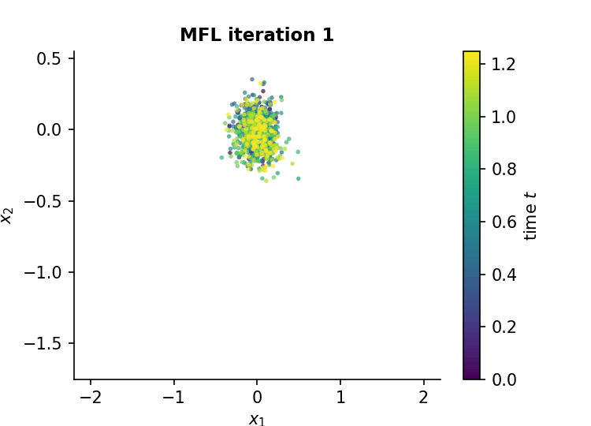

# Trajectory Inference via Mean-Field Langevin in Path Space: an interactive guide

A from-scratch, fully executable walkthrough of

> L. Chizat\*, S. Zhang\*, M. Heitz, G. Schiebinger. **Trajectory Inference via Mean-field Langevin in Path Space.** *NeurIPS 2022.* [arXiv:2205.07146](https://arxiv.org/abs/2205.07146)

<p align="center">
  
</p>

**Trajectory inference** asks how individuals in a population move over time when we can only take *snapshots* of the population, never following the same individual twice. This is the situation in single-cell RNA sequencing, where measuring a cell destroys it. The paper computes the *min-entropy estimator* of Lavenant et al., the law on paths closest (in relative entropy) to Brownian motion among those that fit the data, using a **grid-free particle method with global convergence guarantees**.

The notebook [`trajectory_inference_mfl.ipynb`](trajectory_inference_mfl.ipynb) works as an interactive version of the paper.

| Section | Content |
|---|---|
| 1–2 | Formal problem statement; why snapshots alone are ambiguous; the drift-diffusion (Waddington landscape) model |
| 3 | The min-entropy estimator in path space and the soft-min data-fitting term |
| 4 | Entropic OT / Schrödinger bridges, log-domain Sinkhorn, and the representer theorem that reduces path space to $T$ coupled marginals |
| 5 | Mean-Field Langevin dynamics: first variations, McKean–Vlasov SDE, convergence theorem, discretised algorithm |
| 6 | Reproduction of **Fig. 2**: optimisation dynamics on a 10-D bifurcating process (+ animation) |
| 7 | Sampling trajectories from the estimator (chained couplings + Brownian bridges) |
| 8 | Reproduction of **Fig. 1**: robustness when only *one* cell is observed per time point |
| 9 | Reproduction of **Fig. 3**: branching / cell division via unbalanced Schrödinger bridges |
| 10 | Simulated annealing (**App. F**) |
| 11 | Interactive widgets: scrub through the optimisation, run your own reconstructions |

Everything is implemented in plain **NumPy/SciPy**, with no OT or deep-learning libraries: a batched log-domain Sinkhorn solver, data-fitting forces, the MFL particle updates, a k-NN entropy estimator and the energy distance.

## Handbook: from optimal transport to trajectory inference

[`handbook/handbook.pdf`](handbook/handbook.pdf) is an 18-page companion text, written in Typst, for readers who know optimal transport and Wasserstein gradient flows but are new to trajectory inference. It covers:
- entropic OT, Sinkhorn and Schrödinger potentials;
- the static and dynamic Schrödinger problems (large deviations, stochastic control, the entropic Benamou–Brenier formula);
- the min-entropy estimator as a multi-marginal Schrödinger problem;
- mean-field Langevin dynamics as a Wasserstein gradient flow whose convergence rests on flat convexity and a log-Sobolev inequality;
- unbalanced transport (Wasserstein–Fisher–Rao / Hellinger–Kantorovich) for cell division and death;
- a list of open problems.

To rebuild it (requires [Typst](https://typst.app) ≥ 0.14):

```bash
python handbook/figures/make_figures.py
typst compile handbook/main.typ handbook/handbook.pdf
```

## Quick start

```bash
pip install -r requirements.txt
jupyter notebook trajectory_inference_mfl.ipynb
```

Running all cells takes roughly 15–20 minutes on a laptop CPU, most of it in the sample-size sweep of Section 8, whose results are cached in `results/`. The widgets in Section 11 need a live kernel; on GitHub's static viewer the rest of the notebook renders with all outputs.

## Notes on fidelity to the paper

* Hyper-parameters follow App. G. The authors' code scales the objective by λ, so their step size η = 0.1 corresponds to η = 0.005 in the paper's parameterisation used here.
* The growth convention for branching (source marginals ∝ e^{+gΔt/2}, targets ∝ e^{−gΔt/2}) follows the authors' reference implementation. The paper's text states the opposite signs.
* In the branching experiment we use a milder maximum growth rate (2.5 instead of 10) so that the observed snapshots stay roughly balanced between branches, as in the paper's Fig. 3.
* The comparison against Global Waddington-OT and the iPSC reprogramming experiment (Sec. 4.3) are not reproduced. See the authors' code at [zsteve/mfl](https://github.com/zsteve/mfl) and [zsteve/gWOT](https://github.com/zsteve/gWOT).

## References

* Chizat, Zhang, Heitz, Schiebinger. *Trajectory Inference via Mean-field Langevin in Path Space.* NeurIPS 2022.
* Lavenant, Zhang, Kim, Schiebinger. *Towards a mathematical theory of trajectory inference.* arXiv:2102.09204, 2021.
* Schiebinger et al. *Optimal-transport analysis of single-cell gene expression identifies developmental trajectories in reprogramming.* Cell, 2019.
* Peyré & Cuturi. *Computational Optimal Transport.* Foundations and Trends in ML, 2019.
